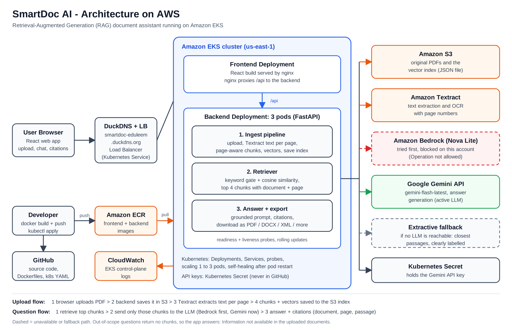

# SmartDoc AI - Intelligent PDF Document Assistant

SmartDoc AI lets users upload PDF documents (and photos of documents) and ask questions in natural language. Answers are generated with Retrieval-Augmented Generation (RAG) and every answer shows its source: the document name, the page number, the supporting passage, and a button to open the original PDF at that page.

- **Project type:** Generative AI + Cloud Engineering (assignment originally written for Azure, implemented on AWS)
- **Platform:** Amazon Web Services, region `us-east-1`
- **Orchestration:** Amazon EKS (Kubernetes)
- **Live URL:** http://smartdoc-eduleem.duckdns.org (HTTP only)

---

## Read this first: what is different from the assignment

The assignment names Azure services. This project uses the AWS equivalent of each one. Two parts do not work the way the assignment describes, and they are listed here openly.

1. **Amazon Bedrock is blocked on this AWS account.** Every Bedrock call fails with `ValidationException: Operation not allowed`. The code tries Bedrock first (Nova Lite for answers, Titan for embeddings), and when that fails it uses the **Google Gemini API** (`gemini-flash-latest`) to write answers. If Gemini is also unreachable, the app shows the closest passages with a clear note that no AI model was available. A support case was raised with AWS.
2. **The vector index is a JSON file in S3**, not a managed search service such as OpenSearch or Azure AI Search. The retriever is our own code (keyword gate plus cosine similarity).
3. **Embeddings are currently hashed word vectors** (512 dimensions), not semantic model embeddings, because Titan is blocked. This is explained in `RAG_IMPLEMENTATION.md`.

---

## Azure to AWS service mapping

| Assignment (Azure) | This project (AWS) | Status |
|---|---|---|
| Azure Blob Storage | Amazon S3 | Working |
| Azure AI Document Intelligence | Amazon Textract | Working (PDF and image OCR) |
| Azure OpenAI (embeddings + answers) | Bedrock Titan + Nova Lite (blocked), Gemini for answers | Gemini active |
| Azure AI Search | Own index stored in S3 (JSON) with keyword + vector scoring | Working, not a managed service |
| Azure Kubernetes Service (AKS) | Amazon EKS | Working |
| Azure Container Registry (ACR) | Amazon ECR | Working |
| Azure Key Vault | Kubernetes Secret (Secrets Manager configured) | Partial |
| Azure Monitor | CloudWatch (EKS control-plane logs) + `kubectl logs` | Partial |

---

## Architecture



Request path: **Browser > DuckDNS + Load Balancer > Frontend (nginx) > Backend (FastAPI, 3 pods) > S3 / Textract / LLM.**

- **Frontend:** React app built and served by nginx. nginx forwards `/api` requests to the backend service.
- **Backend:** Python FastAPI with a document-processing API and a question-answering API.
- **AI pipeline:** PDF extraction, text chunking, embedding generation, vector indexing, RAG, source-citation generation.
- **Storage:** original files and the index live in one S3 bucket.

The full explanation of each step is in [RAG_IMPLEMENTATION.md](RAG_IMPLEMENTATION.md).

---

## Features

**Required by the assignment**
- Upload PDFs through a web interface, store them in S3, show each document's name and processing status
- Multiple PDFs; invalid or unsupported files are rejected with a clear message
- Text extraction with Textract, preserving page numbers and document metadata
- Page-aware text chunking
- Question answering grounded only in the retrieved passages
- Out-of-scope questions answer: *"Information not available in the uploaded documents."*
- Citations on every answer: document name, page number, supporting passage, and open the PDF at that page
- Chat interface with conversation history (stored in the browser)

**Optional challenges completed**
- Multi-document question answering
- Hybrid search (keyword gate combined with vector similarity)
- OCR for scanned PDFs and photos (Textract)
- Conversation history (follow-up questions such as "he" or "it" are resolved from earlier turns)

**Extras**
- "Format on request": if the user asks for the answer *in PDF / Word / XML / JSON / CSV / TXT / Markdown*, a download button for that format appears on that message only. Without such a request, no button appears.
- Delete for documents and chats, Copy and Edit buttons on messages, Shift+Enter for new lines
- Chat-only attachments (separated in the interface; this is not real access control)

---

## Project structure

```
smartdoc-ai/
  backend/
    Dockerfile
    requirements.txt
    app/
      main.py                  FastAPI routes (upload, documents, chat, export)
      config.py                settings
      text_utils.py            keyword extraction and stop words
      services/
        s3_service.py          upload and presigned PDF links
        textract_service.py    Textract extraction and page-aware chunking
        bedrock_service.py     embeddings, answer generation, Gemini, fallback
        vector_service.py      S3-backed index and search
        exporters.py           PDF / DOCX / XML / JSON / CSV / TXT / MD export
  frontend/
    Dockerfile
    src/App.jsx                chat UI, upload, citations, viewer
  k8s/                         Kubernetes YAML and eks-cluster.yaml
  tools/                       helper scripts and backups
  architecture.png / .svg      architecture diagram
  Sample_HR_Policy.pdf         sample document used for testing
  RAG_IMPLEMENTATION.md        RAG documentation
```

---

## Run and deploy

Replace `<ACCOUNT_ID>` with your AWS account ID.

**Build and push images to ECR**

```powershell
docker build -t <ACCOUNT_ID>.dkr.ecr.us-east-1.amazonaws.com/smartdoc-backend:latest ./backend
docker build -t <ACCOUNT_ID>.dkr.ecr.us-east-1.amazonaws.com/smartdoc-frontend:latest ./frontend
docker push <ACCOUNT_ID>.dkr.ecr.us-east-1.amazonaws.com/smartdoc-backend:latest
docker push <ACCOUNT_ID>.dkr.ecr.us-east-1.amazonaws.com/smartdoc-frontend:latest
```

**Create the cluster and deploy**

```powershell
eksctl create cluster -f k8s\eks-cluster.yaml
kubectl apply -f k8s\
kubectl get pods
kubectl get svc
```

**Store the Gemini key as a Kubernetes Secret (never in Git)**

```powershell
kubectl create secret generic gemini-key --from-literal=GEMINI_API_KEY="<your key>"
kubectl set env deployment/smartdoc-backend --from=secret/gemini-key
```

**Scaling and pod recovery**

```powershell
kubectl scale deployment smartdoc-backend --replicas=1
kubectl scale deployment smartdoc-backend --replicas=3
kubectl get pods
kubectl delete pod <one-backend-pod-name>
kubectl get pods -w
```

**Update after a code change**

```powershell
docker build -t <ACCOUNT_ID>.dkr.ecr.us-east-1.amazonaws.com/smartdoc-backend:latest ./backend
docker push <ACCOUNT_ID>.dkr.ecr.us-east-1.amazonaws.com/smartdoc-backend:latest
kubectl rollout restart deployment smartdoc-backend
kubectl rollout status deployment smartdoc-backend
```

**Delete everything when finished (the cluster bills every hour)**

```powershell
eksctl delete cluster -f k8s\eks-cluster.yaml
```

---

## Mandatory test cases

Tested with `Sample_HR_Policy.pdf` (Northwind Technologies HR handbook, 3 pages).

| Test case | Question or action | Expected result |
|---|---|---|
| Upload a valid PDF | Upload `Sample_HR_Policy.pdf` | Document appears with status ready |
| Annual leave | "What is the annual leave entitlement?" | 24 days per year, cited to page 1 |
| Sick leave | "How many sick leaves are employees eligible for?" | 12 days per year, cited to page 2 |
| Maternity leave | "What is the maternity leave policy?" | 26 weeks for the first two children and 12 weeks after, cited to page 2 |
| Notice period | "What is the employee notice period?" | 60 days (30 days in probation), cited to page 3 |
| IT security | "What are the company's IT security guidelines?" | Password, MFA, storage and reporting rules, cited to page 3 |
| Not covered | "What is the capital of France?" | "Information not available in the uploaded documents." with no citations |
| Multiple PDFs | Upload a second PDF | Both indexed separately and listed |
| Multi-section question | "Compare annual, sick and casual leave" | Several sections retrieved and cited |
| Pod restart | Delete one backend pod | Kubernetes recreates it; the app keeps answering |
| Scale pods | Scale backend from 1 to 3 replicas | App stays operational |

Evidence for these tests is in the `screenshots/` folder (add yours there).

---

## Security and monitoring

- API keys are held in a Kubernetes Secret and are never committed to GitHub. Before every push, run `git grep -n "AIza"` to confirm no key is in the repository.
- Browsers receive time-limited presigned S3 links, so the bucket is not public.
- Monitoring: EKS control-plane logs go to CloudWatch, and application logs are read with `kubectl logs`. Backend log lines show which AI path answered (`[Gemini OK]`, `[Bedrock unavailable]`, `[Gemini Fallback Triggered]`).
- Kubernetes readiness and liveness probes use the `/health` endpoint.

---

## Known limitations

- Bedrock is blocked on this account, so answers come from Gemini. The Gemini free tier has rate limits and can return HTTP 503 or 429 under load, in which case the app shows the labelled fallback passages.
- The Gemini free tier may use submitted data to improve Google products, so do not upload confidential documents.
- Embeddings are hashed word vectors, so search is keyword-driven. A question that uses different words from the document (for example "holiday" for "leave") may not match. A local embedding model is the planned improvement.
- The index is one JSON file in S3. Pods reload it when its ETag changes. This does not scale to large document sets the way a managed search service would.
- Pods use a broad node IAM role. Least-privilege roles for pods (IRSA) are the next security step.
- Only control-plane logs are sent to CloudWatch. Container logs are not shipped there yet.
- The site runs over HTTP, not HTTPS.
- Chat history is stored in the browser only (basic implementation, as the assignment allows).
- Word, Excel and PowerPoint files are not supported yet. PDF is the supported document format, with PNG and JPG for photos.
